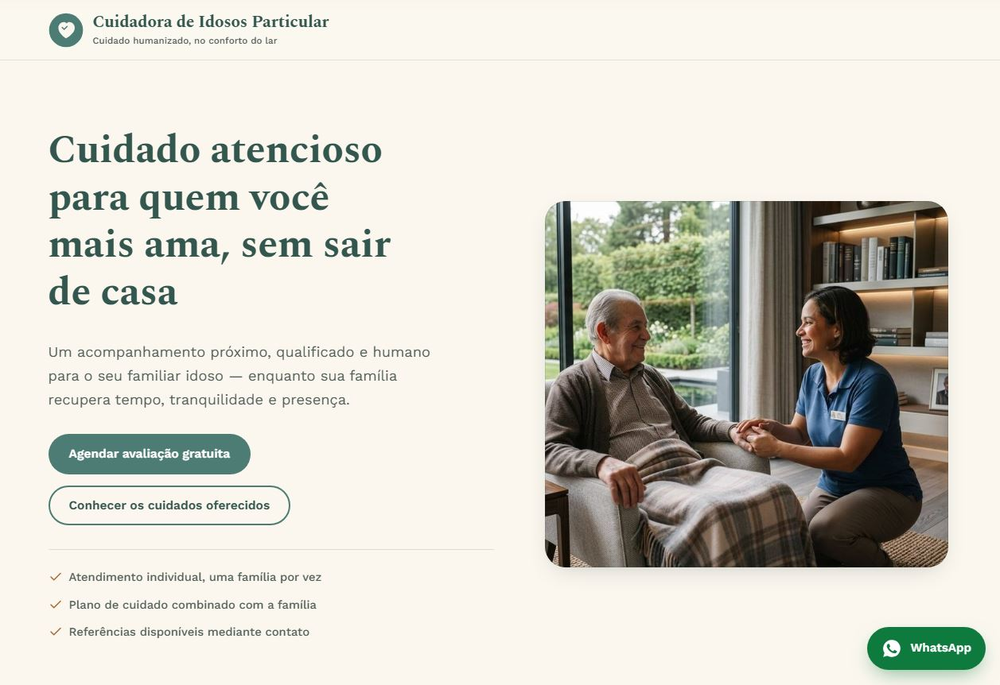
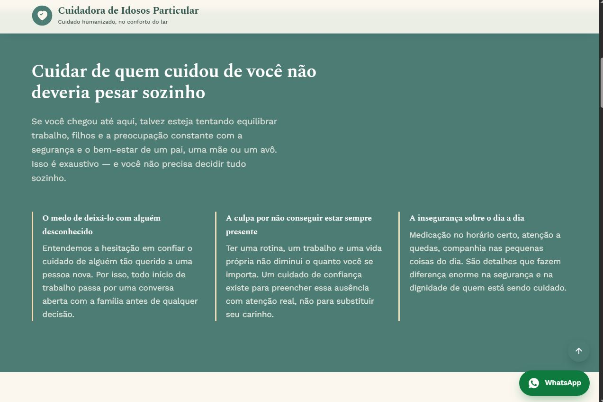
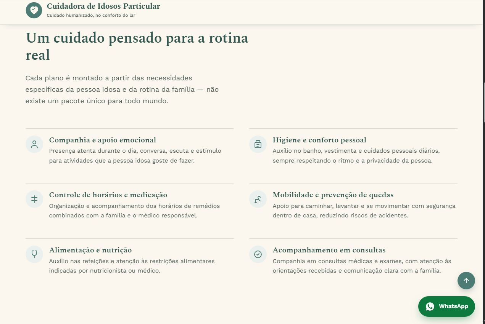
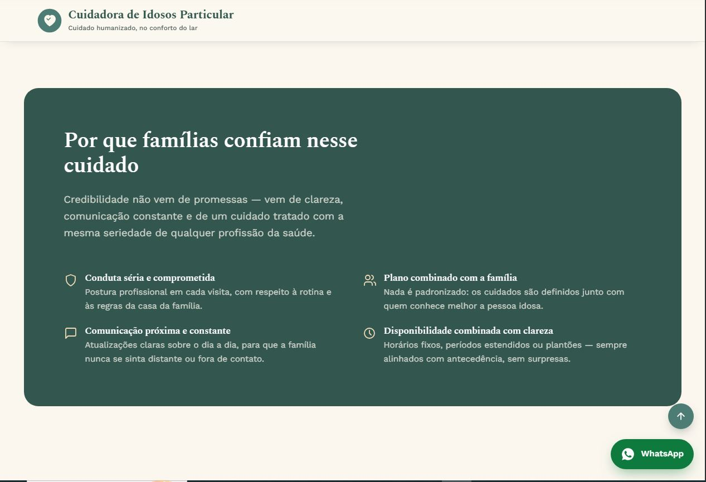
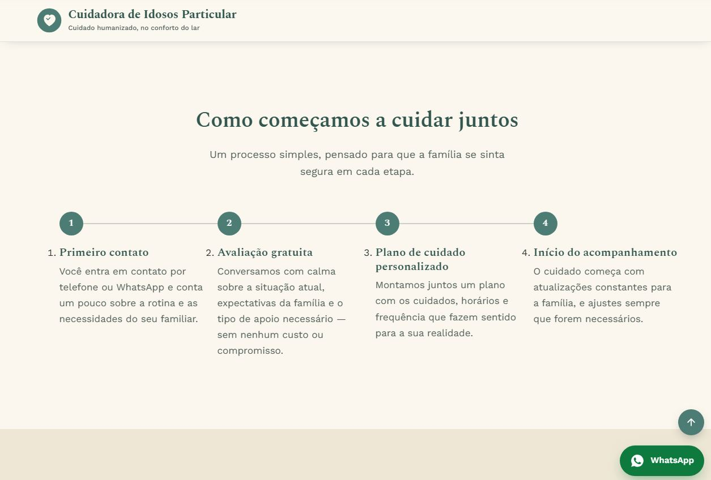
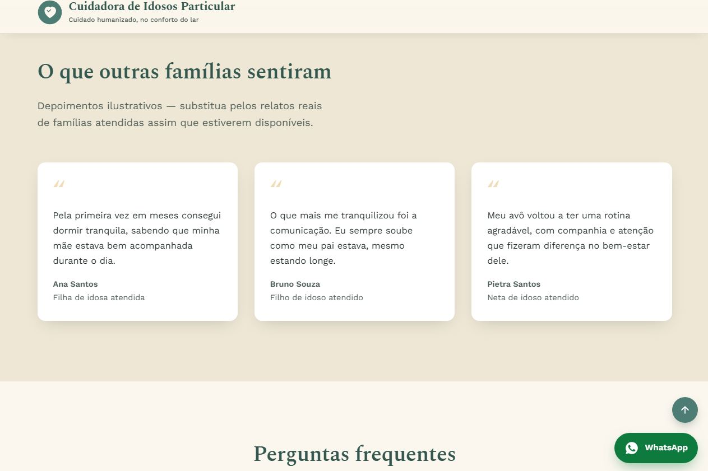
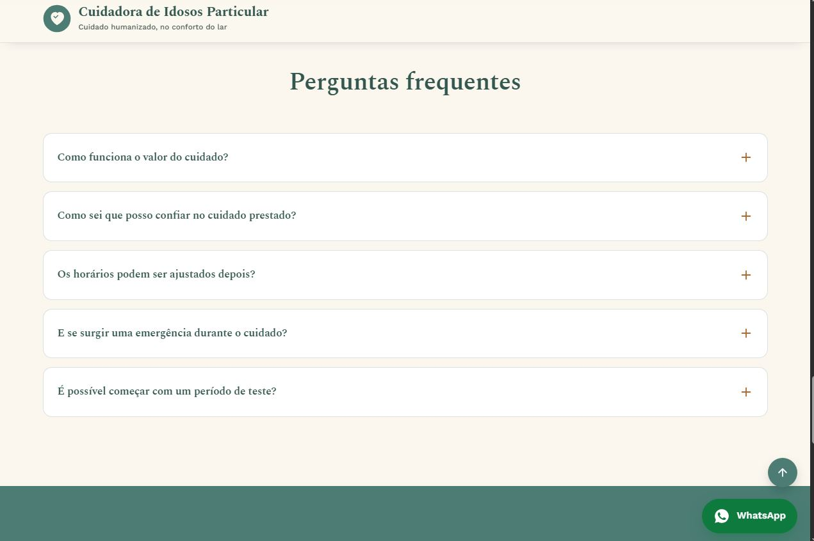
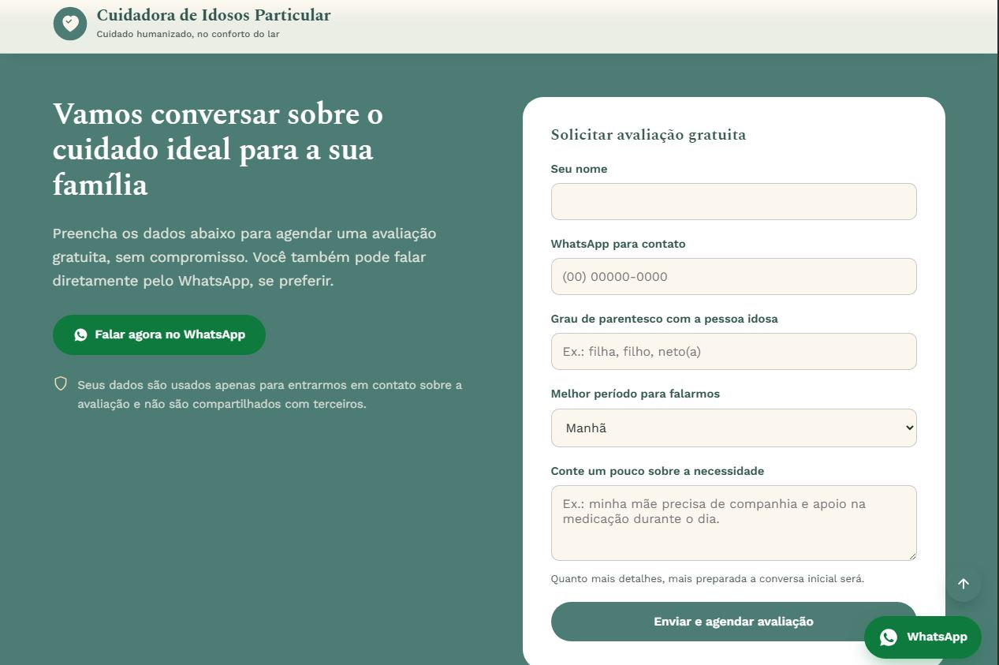
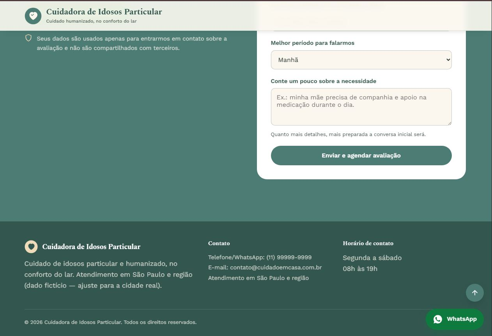

# Cuidadora de Idosos Particular — Landing Page

Landing page de alta conversão para serviços particulares de cuidador(a) de idosos, focada em agendamento de avaliações gratuitas via WhatsApp.


**[🔗 Ver demonstração ao vivo](https://li-code1.github.io/cuidado-em-casa)**

## Sobre o projeto

Página única (one-page) construída para converter visitantes em agendamentos, não apenas gerar visitas. O conteúdo foi escrito para dialogar diretamente com a dor emocional de quem busca um cuidador de confiança para um familiar idoso — medo do desconhecido, culpa por não estar sempre presente e insegurança com a rotina de cuidados.

**Estrutura da página:**

1. Cabeçalho fixo com logo e nome da marca
2. Hero com proposta de valor e chamada principal
3. Seção de empatia com as dores do público
4. Serviços oferecidos
5. Diferenciais / por que confiar
6. Como funciona (processo em etapas)
7. Depoimentos
8. Perguntas frequentes (acordeão nativo, sem JS)
9. Formulário de agendamento integrado ao WhatsApp
10. Rodapé com dados de contato
11. Botão flutuante de WhatsApp (fixo em todas as seções)

## Capturas de tela

<table>
<tr>
<td width="50%">

**Hero**


</td>
<td width="50%">

**Seção de empatia**


</td>
</tr>
<tr>
<td width="50%">

**Serviços**


</td>
<td width="50%">

**Diferenciais**


</td>
</tr>
<tr>
<td width="50%">

**Como funciona**


</td>
<td width="50%">

**Depoimentos**


</td>
</tr>
<tr>
<td width="50%">

**Perguntas frequentes**


</td>
<td width="50%">

**Agendamento**


</td>
</tr>
<tr>
<td width="50%">

**Rodapé**


</td>
<td width="50%"></td>
</tr>
</table>

## Tecnologias

- HTML5 semântico
- CSS3 puro (sem frameworks), com variáveis (`custom properties`), `clamp()` para tipografia fluida e `grid`/`flexbox` para o layout
- JavaScript puro (vanilla), sem dependências
- Google Fonts: [Spectral](https://fonts.google.com/specimen/Spectral) (títulos) e [Work Sans](https://fonts.google.com/specimen/Work+Sans) (texto)

## Estrutura de arquivos

```
├── index.html         # Estrutura e conteúdo da página
├── style.css          # Estilos, cores, tipografia e responsividade
├── script.js          # Comportamento: header ao rolar, ano automático, formulário → WhatsApp
├── screenshots/        # Capturas de tela usadas neste README
└── README.md          # Este arquivo
```

## Como visualizar localmente

Não é necessário nenhum servidor ou instalação. Basta abrir o arquivo `index.html` diretamente no navegador, ou usar uma extensão como o **Live Server** (VS Code) para recarregamento automático durante a edição.

## Publicando no GitHub Pages

1. Suba os arquivos (`index.html`, `style.css`, `script.js`) e a pasta `screenshots/` para a raiz do repositório
2. Vá em **Settings → Pages**
3. Em **Source**, selecione a branch principal (`main`) e a pasta `/root`
4. Salve — o GitHub gera automaticamente a URL de publicação em alguns minutos

🔗 Publicado em: **https://li-code1.github.io/cuidado-em-casa**

## Antes de publicar — dados fictícios a substituir

O conteúdo usa dados de exemplo que **precisam ser trocados** antes de colocar a página no ar. Procure por essas ocorrências no `index.html`:

| Dado | Valor fictício atual | Onde aparece |
|---|---|---|
| WhatsApp / telefone | `(11) 99999-9999` | Formulário, botão flutuante, rodapé, `script.js` |
| E-mail | `contato@cuidadoemcasa.com.br` | Rodapé |
| Cidade/região | `São Paulo e região` | Rodapé, dados estruturados (JSON-LD) |
| Depoimentos | Ana Santos, Bruno Souza, Pietra Santos | Seção "O que outras famílias sentiram" |

> ⚠️ Os depoimentos ainda têm falas fictícias. Substitua por relatos reais de famílias atendidas antes de publicar — apresentar uma citação inventada com nome de pessoa real (ou fictício) como se fosse um depoimento verdadeiro pode configurar propaganda enganosa.

Para trocar o número de WhatsApp, atualize o formato internacional `55DDDNÚMERO` (ex.: `5511987654321`) nos três pontos indicados acima, incluindo dentro do `script.js` na constante `WHATSAPP_NUMERO`.

## Foto do hero

A imagem principal já está embutida diretamente no `index.html` em base64 (não depende de nenhum arquivo externo). Para trocá-la:

1. Otimize a nova foto (recomendado: até ~1200px de largura, JPEG qualidade ~80, para manter a página leve)
2. Converta para base64 (ex.: [base64.guru](https://base64.guru/converter/encode/image))
3. Substitua o conteúdo dentro de `src="data:image/jpeg;base64,...."` na tag `` da seção `hero-visual`

## Acessibilidade

- Navegação por teclado com foco visível (`:focus-visible`)
- Link de "pular para o conteúdo principal"
- Hierarquia de títulos (`h1`–`h4`) consistente
- Textos alternativos em imagens e ícones decorativos marcados com `aria-hidden`
- Acordeão de perguntas frequentes com `<details>`/`<summary>` nativo, sem necessidade de JavaScript
- Respeita `prefers-reduced-motion` para quem desativa animações no sistema

## SEO

- Meta description e Open Graph configurados
- Dados estruturados (`schema.org/Service`) em JSON-LD para melhor indexação no Google
- HTML semântico (`header`, `main`, `section`, `article`, `address`, `footer`)

## Licença

Projeto de uso livre para personalização e publicação pelo proprietário do conteúdo.
